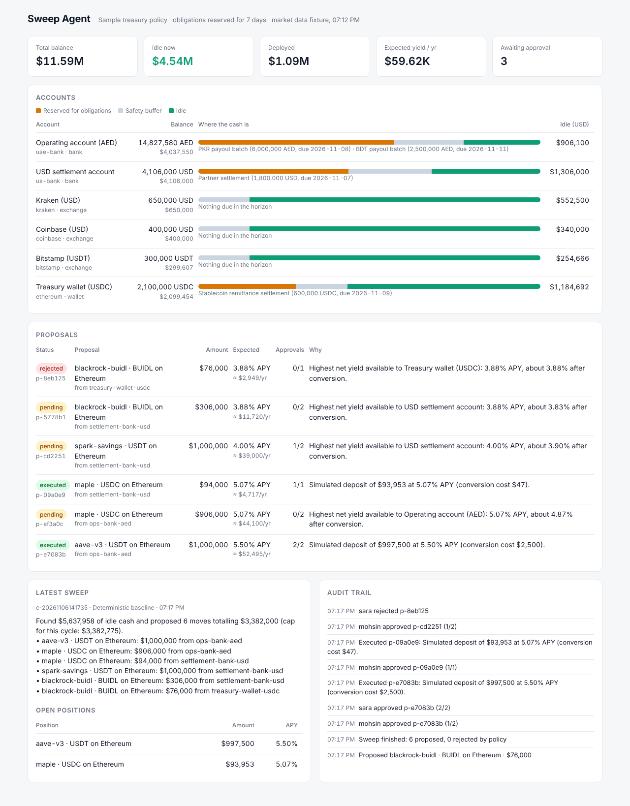
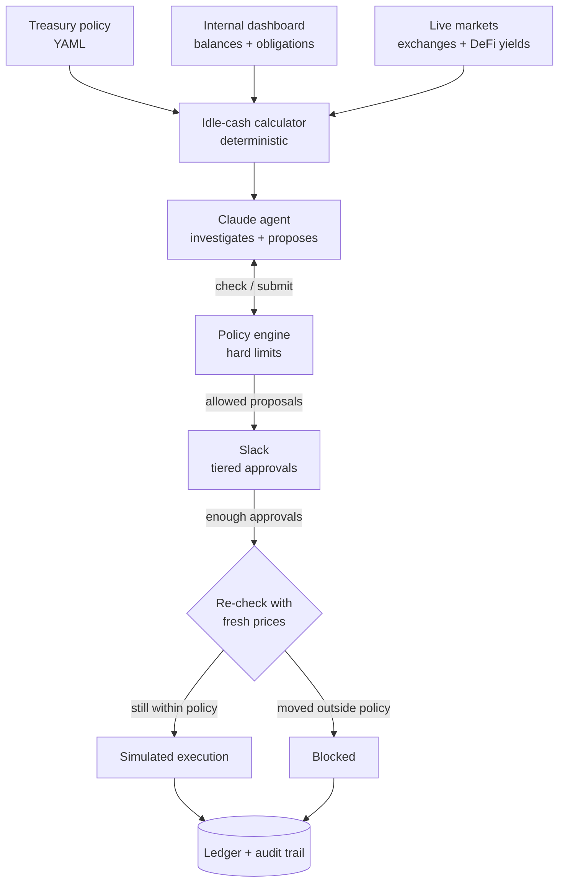

# sweep-agent

**A policy-bound AI treasury agent.** It finds cash sitting idle across bank, exchange and wallet accounts, looks for ways to put it to work (stablecoin yield, tokenized treasuries, cross-venue arbitrage, spot), and proposes moves in Slack. Nothing happens until the right people approve, and every move is re-checked against fresh prices before it executes.

> The model proposes. Code decides what's allowed. People approve.



## Why

Payments and fintech companies keep large balances spread across banks, exchanges and wallets so they can always pay out. Most of that cash is needed. Some of it isn't, and it earns nothing.

Working out how much is truly free means knowing every balance, every payout due this week, and every buffer the treasury team wants to keep. Then someone has to compare yields and spreads that change by the minute. This agent does that work, and keeps the people who own the money in control.

## How it works



1. **Idle cash is calculated, not guessed.** For each account: balance, minus obligations due within the horizon (payout batches, partner settlements), minus a safety buffer. This is plain code. The model never decides how much cash is free.
2. **The agent investigates.** Claude gets tools to read the treasury snapshot and the policy, scan live yields and spreads, and dry-run proposals. It writes a rationale and the risks for every proposal.
3. **The policy engine is the guardrail.** Every proposal goes through `src/policy/engine.ts`. It looks up each APY, price and spread itself, so the model can't invent a number or talk its way past a limit. Rejections go back to the agent with reasons, so it can fix the proposal or drop it.
4. **People approve in Slack.** Bigger tickets need more approvers (1 up to $250k, 2 up to $1M, 3 up to $3M). Spot buys always need two. One person can't approve twice.
5. **Everything is re-checked before execution.** Prices and yields move between approval and execution. If anything is now outside the policy, the move is blocked rather than executed.
6. **Execution is simulated.** This repo never moves real money. Executions update a local ledger, which feeds back into the dashboard balances, so the next sweep sees the result.

## What it can propose

| Instrument | Example | Key limits in the sample policy |
|---|---|---|
| Stablecoin yield | Maple USDC on Ethereum | Allowed projects and chains, TVL ≥ $100M, APY 3–12%, ≤ $1M per project |
| Tokenized treasuries | BlackRock BUIDL, Invesco USTB | Allowed funds and chains, APY 3–8%, ≤ $2M per fund |
| Cross-venue arbitrage | Buy BTC on Kraken, sell on Bitstamp | Net spread after both taker fees ≥ 5 bps, ≤ $200k notional, funded on the buy venue |
| Spot | BTC, ETH | ≤ $250k per asset, two approvers |

Across everything: at most 60% of idle cash per sweep, at most $5M deployed in total, conversion costs (AED → USDC and so on) charged against the expected return, and routes the policy doesn't list are refused.

Cash already sitting in proposals that are waiting for approval counts as spoken for, so a second sweep won't propose the same money twice.

## Quickstart

Needs Node 20 or newer.

```bash
npm install
cp .env.example .env

npm run sweep          # one sweep with live market data
npm run proposals      # what's waiting for approval
npm run approve -- <id> --as mohsin
npm run dashboard      # http://localhost:4100
```

Without an `ANTHROPIC_API_KEY`, sweeps run a **deterministic baseline** (greedy: best net yield first, inside every limit). Add a key to `.env` to run the Claude agent instead. The baseline is also a useful benchmark: the agent should beat it on judgement, not on taking more risk.

Other commands:

```bash
npm run sweep -- --offline     # use the recorded market snapshot in fixtures/
npm run sweep -- --baseline    # force the baseline even with a key set
npm run snapshot               # idle cash and opportunities, no proposals
npm run reject -- <id> --as sara
npm run record-fixture         # refresh fixtures/market-snapshot.json from live data
npm run reset                  # clear proposals, positions and the audit log
npm test
```

### Example sweep

```
Account                  Ccy      Balance   Reserved     Buffer       Idle  Idle (USD)
Operating account (AED)  AED   18,500,000  8,500,000  3,000,000  7,000,000  $1,906,100  ●
USD settlement account   USD    4,200,000  1,800,000  1,000,000  1,400,000  $1,400,000  ●
Treasury wallet (USDC)   USDC   2,100,000    600,000    315,000  1,185,000  $1,184,692  ●
...
Total balance $12,686,611 · Actionable idle $5,637,958

ID        Proposal                          From                     Amount  Expected                Approvals
p-e7083b  aave-v3 · USDT on Ethereum        ops-bank-aed         $1,000,000  5.50% APY ≈ $52,495/yr  0/2
p-ef3a0c  maple · USDC on Ethereum          ops-bank-aed           $906,000  5.07% APY ≈ $44,100/yr  0/2
p-cd2251  spark-savings · USDT on Ethereum  settlement-bank-usd  $1,000,000  4.00% APY ≈ $39,000/yr  0/2
...
```

Live cross-venue spreads are usually negative after fees, so you'll mostly see the engine turn arbitrage down. That's the point.

## Slack setup

1. Go to [api.slack.com/apps](https://api.slack.com/apps) → **Create New App** → **From an app manifest**, and paste `slack/manifest.yaml`.
2. Install it to your workspace. Copy the **Bot User OAuth Token** (`xoxb-…`) to `SLACK_BOT_TOKEN`.
3. Under **Basic Information → App-Level Tokens**, create a token with `connections:write`. Copy it (`xapp-…`) to `SLACK_APP_TOKEN`.
4. Invite the bot to a channel, then run `npm run slack` and type `/sweep` there.

Each proposal arrives as its own message with **Approve** and **Reject** buttons, the rationale, the risks and how many approvals it needs. The message updates as people approve, and the result of the execution (or why it was blocked) is posted in the thread.

To run sweeps on a schedule, set `SLACK_CHANNEL_ID` and `SWEEP_INTERVAL_MINUTES`. To limit who can approve, list Slack user IDs under `approvals.allowed_approvers` in the policy.

## Make it yours

- **Policy:** edit `policies/treasury-policy.yaml`. Every limit in it is enforced in code, and the file is validated on load, so a typo fails loudly rather than silently loosening a rule.
- **Balances:** point `DASHBOARD_URL` at your internal treasury API. It needs one endpoint, `GET /api/treasury`, returning `{ asOf, accounts[], obligations[] }` in the shape of `src/types.ts`. `npm run dashboard` serves exactly that from `data/treasury.json`, so you can see the contract.
- **Venues:** add a fetcher to `src/sources/markets.ts` and a fee to the policy.
- **Execution:** `src/execution/simulator.ts` is the only place that changes balances. Replacing it with real bank or exchange calls is deliberately left out of this repo.

## Project layout

```
policies/treasury-policy.yaml   the rules the agent is bound by
data/treasury.json              fictional balances and upcoming obligations
fixtures/market-snapshot.json   recorded live market data for offline runs and tests
src/
  treasury/idle-cash.ts         balance − obligations due − buffer
  policy/engine.ts              the guardrail: every check, every limit
  strategies/opportunities.ts   yield filters and net arbitrage spreads
  agent/                        Claude tool loop, tools, prompt, and the baseline
  approval/slack.ts             /sweep and Approve / Reject buttons
  execution/simulator.ts        approvals, re-check, simulated execution
  dashboard/                    stand-in for the internal treasury dashboard
  sources/                      dashboard, exchange and yield adapters
test/                           engine, idle cash, approvals and the agent loop
```

## Limits

- Execution is simulated. Arbitrage is modelled as an instant round trip, which ignores inventory on the sell venue and settlement time.
- Yields come from DeFiLlama and prices from public exchange APIs. Both are third-party data; check them before trusting a number.
- Balances and obligations in `data/` are made up.
- This is a reference implementation of the control model, not financial advice.

## License

MIT
